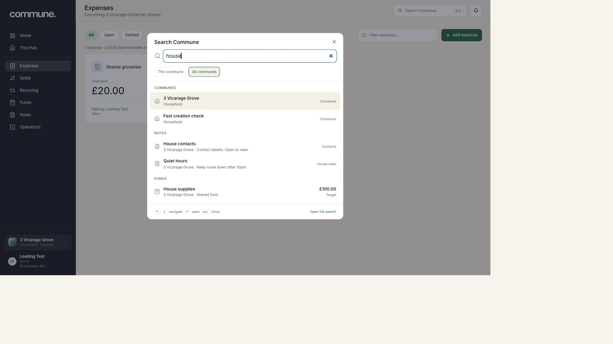
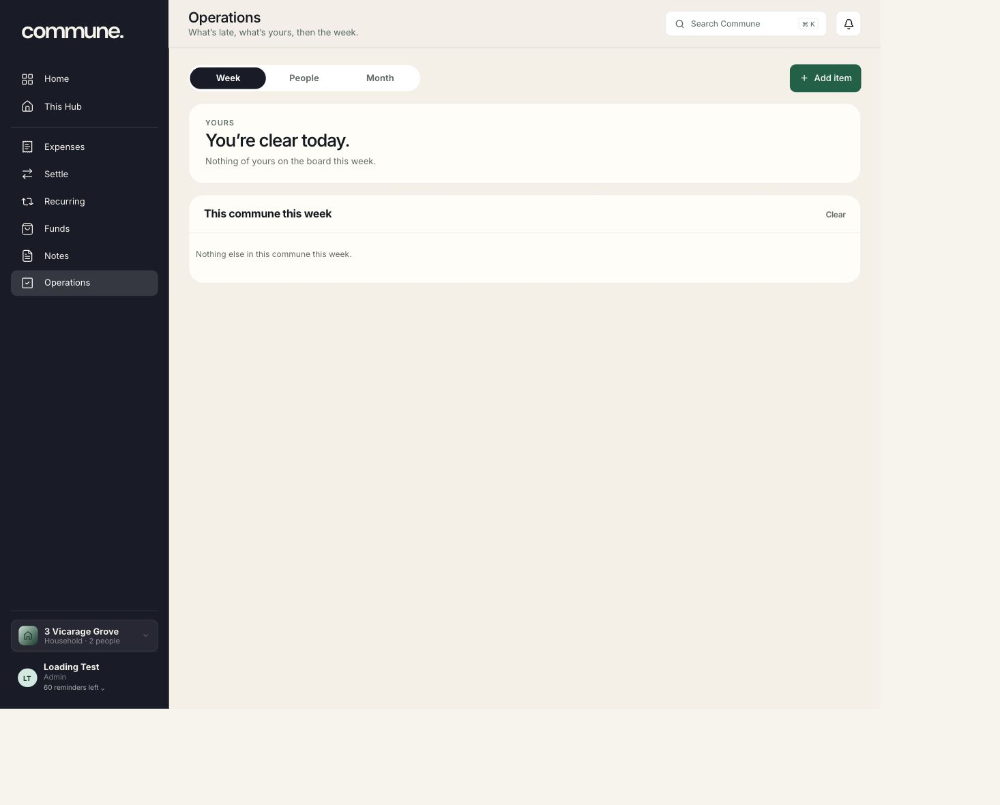
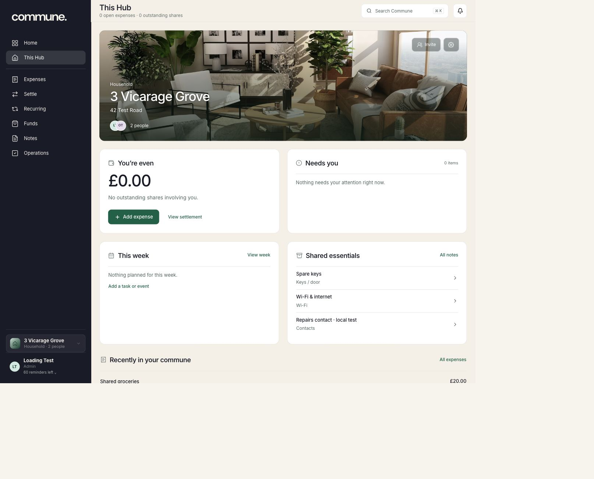
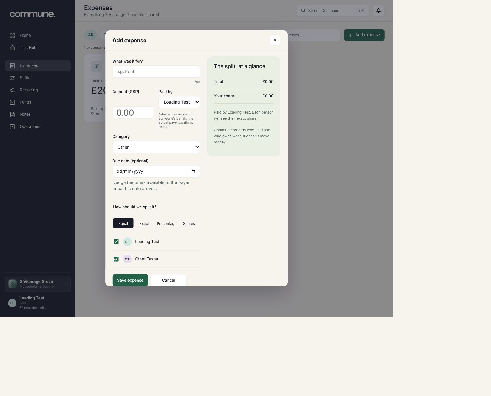
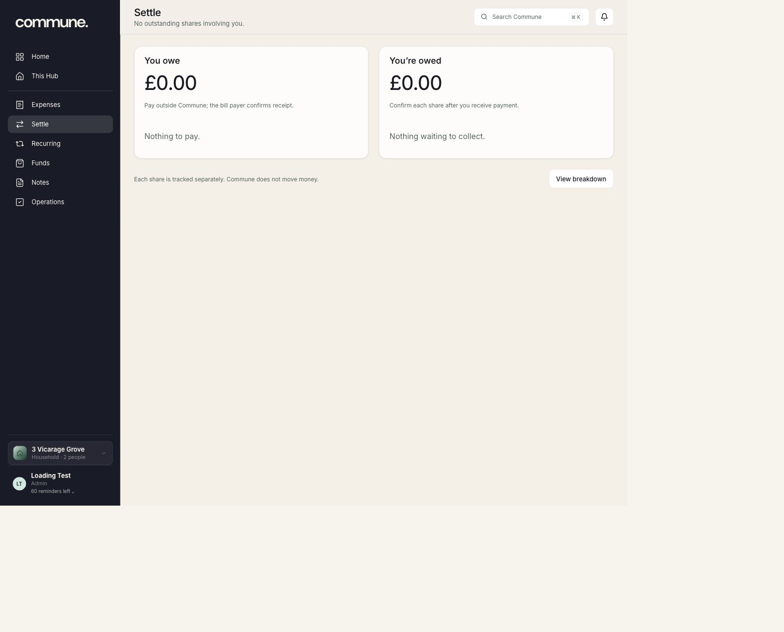
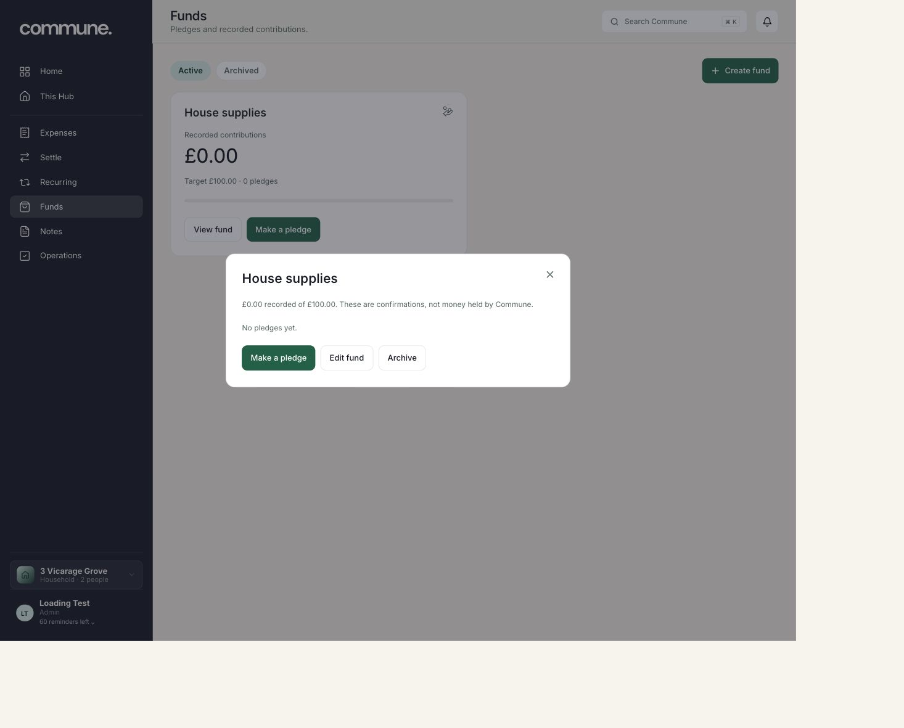
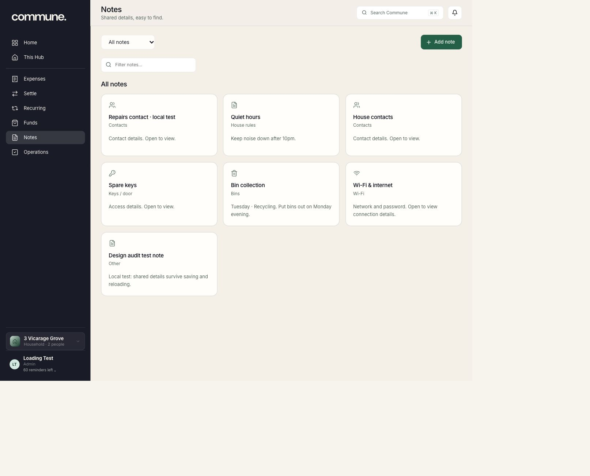

# Commune product depth review — 2 October 2026

Read-only review of the actual local app and source, not a new mockup, full
transaction QA, hosted release or production/native certification. Existing QA
data was preserved; the expense form was cancelled without saving.

The [full roadmap](../../docs/PRODUCT-DEPTH-ROADMAP-2026-10-02.md) contains the
functional gap evidence, priorities, mobile strategy and acceptance gates.
Every screenshot below was captured, saved and visually inspected this run.

## 1 — Find an existing record

**Health: useful foundation.** Grouped results and explicit commune scope help
finding something without confusing global search with local filters. Next:
durable record links and sign-in return paths, not another search UI.

Accessibility: shortcut/grouping visible; verify keyboard selection, screen-reader
announcements and close/focus restore interactively. This screenshot does not
prove cross-account permissions or revoked-access behaviour.

## 2 — Check Operations for this week

**Health: calm empty state; populated lifecycle not exercised.** Personal versus
commune work is clear; Add item stays obvious. Keep repeat/rotation and the date
geometry. Source, not this empty screenshot, identifies the need for stable
assignee identity, occurrence history and concurrent completion safety.

Accessibility: Week is visibly selected; keyboard tab navigation and changes
announced to assistive technology still need interactive checks.

## 3 — Understand the selected Hub

**Health: coherent layout; prioritisation needs richer context.** The photo,
balance, needs, week and essentials have readable hierarchy. An all-settled Hub
should stay calm. Populated attention items need owner, due context and one action;
recent expenses alone are not a full contextual history.

Accessibility: measure overlay-text contrast on actual chosen photos, long
titles, large text and quiet secondary controls. The recent area is only partly
within this viewport; no finding claims its below-fold contents were inspected.

## 4 — Open Add expense, then cancel

**Health: useful real form; after-creation lifecycle needs depth.** Payer, amount,
category, date and all four split modes are present; summary explains personal
share. The form correctly says Commune does not move money. Nothing was saved.

UX: payer explanation occupies substantial space and disrupts amount/payer
alignment. Keep policy help available without crowding the entry path. Expense
and Fund dialogs use different placement/density: share interaction primitives
without forcing identical workflow dimensions.

Accessibility: labels/named controls exist in DOM. Verify short viewport, keyboard,
zoom and error announcements; don't explain split validity through colour alone.

## 5 — Read settlement

**Health: clear empty money semantics; partial lifecycle absent in code.** Adjacent
owing/owed panels compare well. Wording separates outside payment from receipt
confirmation. Current data is already settled; no payment or Nudge was exercised.

Source finding: confirmation settles a whole share, not an entered partial amount.
Add amount/date/history/reversal; a debtor's “sent” claim is not payer receipt.

Accessibility: totals have textual headings; test reading order/stacking at large
text sizes. Empty panels need not impose excessive space with no action available.

## 6 — Open fund detail, then close

**Health: honest controls; financial context could be richer.** View, pledge, edit
and archive appear; detail says contributions, not money held by Commune. Nothing
was pledged, edited or archived. Existing source already includes fund contribution
records/corrections; those are not missing features.

UX: short generic detail can gain target/promised/received/date/contributor
hierarchy as data grows. Preserve unresolved-pledge archival guards.

Accessibility: close is named in DOM. The glyph is not a measured hit target;
test its area, focus/restore and contribution-error announcements.

## 7 — Browse Notes

**Health: useful board with guarded private previews.** Contact, access and Wi-Fi
values are not shown on cards. Local filter and global finder remain distinct.
Next: history/conflict safety, copy/call/map and private attachments, not generic
project-management columns.

UX: filter and search occupy separate rows; a clearer responsive toolbar can keep
both capabilities without replacing the board. Small collections need no extra
categorisation.

Accessibility: whole cards have descriptive names. Verify keyboard order, overflow,
zoom and textual icon/status equivalents. Masking previews is not encryption or
authorisation evidence.

## Overall finding and evidence limits

The local foundation is usable. Deeper quality comes from complete lifecycles,
consistent consequential actions, shared-state freshness and proven online
reliability. Keep the brand/spatial model rather than restarting the design.

This review did not send email, change records/preferences/permissions, exercise
populated Operations, benchmark hosted starts, certify accessibility, audit every
policy or run a native app. Functional findings come from source separately from
screenshots. Previous logged test passes were not rerun. No deployed-parity or
100k capacity claim is made here.
