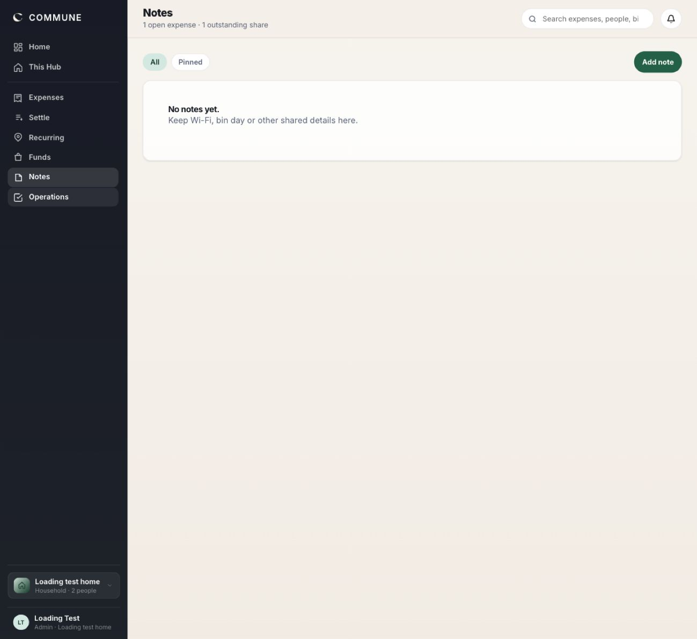
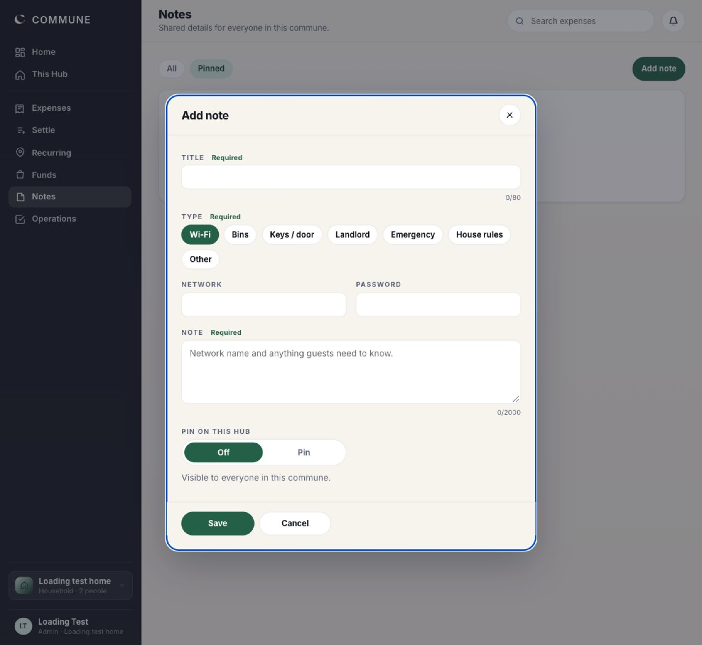
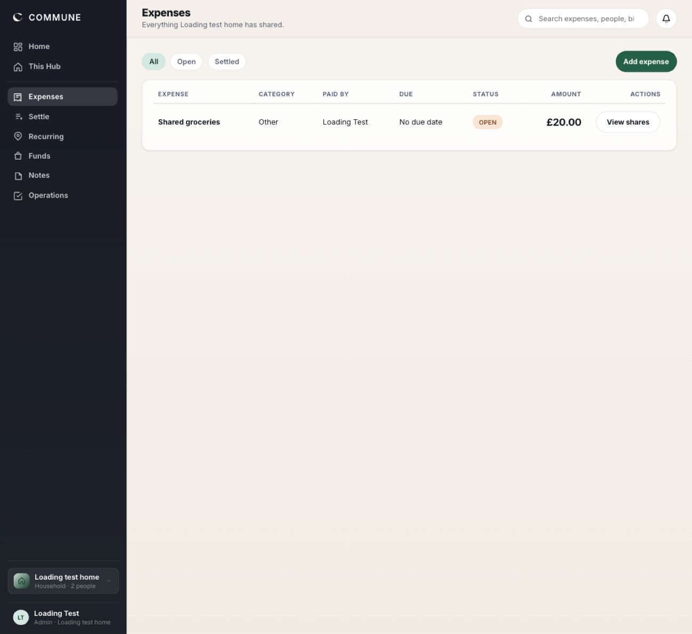
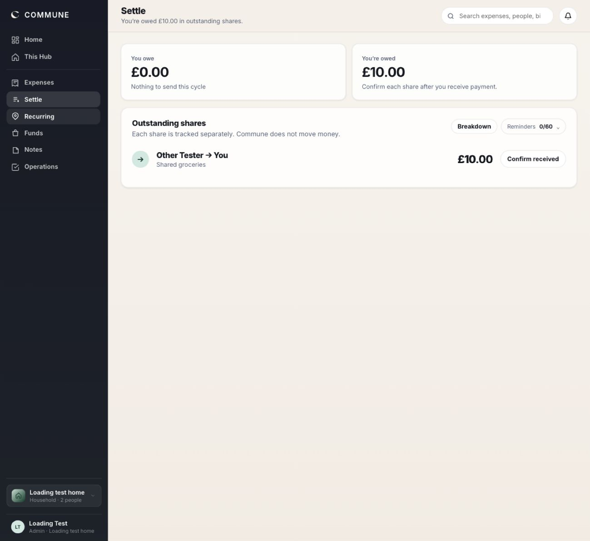
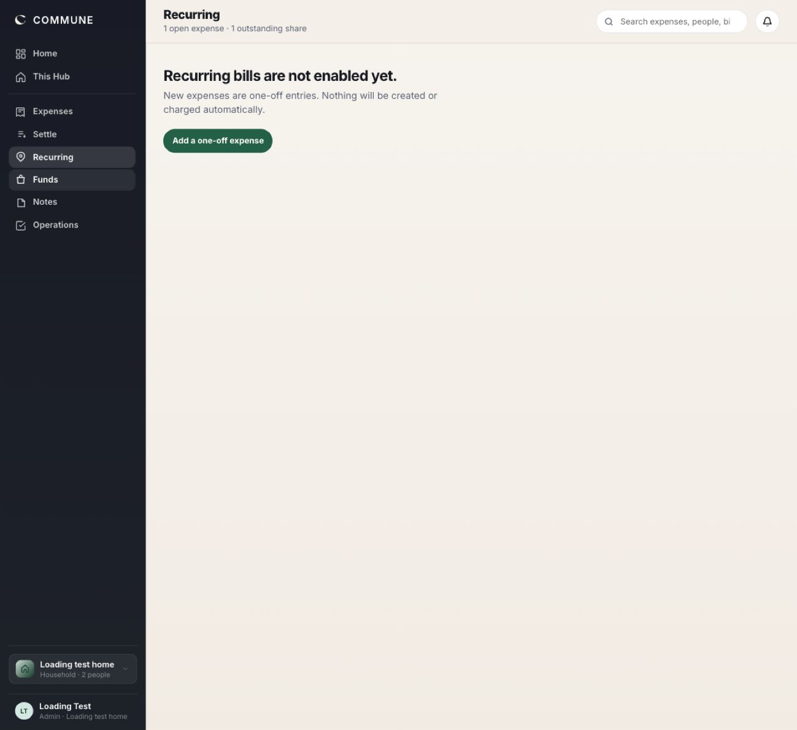
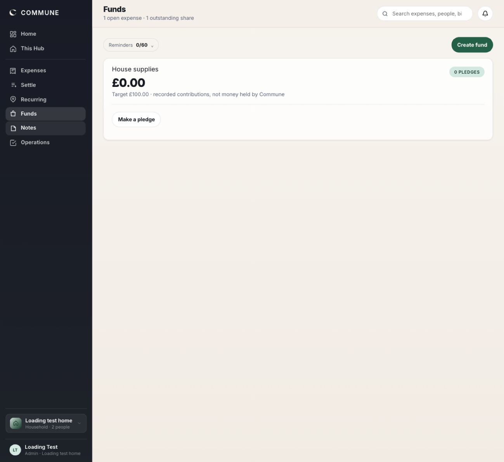
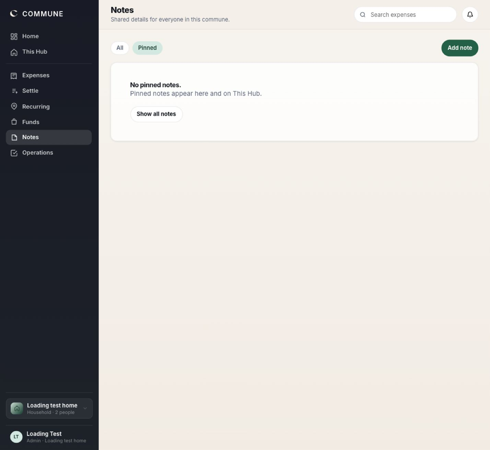
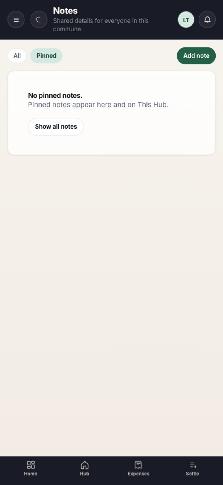
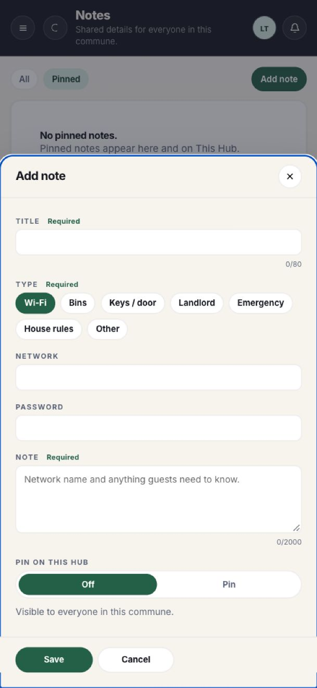

# Local design and function review — 27 September 2026

Scope: the signed-in local test account, Notes and its creation flow, Expenses,
Settle, Recurring and Funds. Product Design audit and React best-practices
guidance informed this pass. This is not an all-features production sign-off.

## Steps and findings

1. **Notes — fixed.** The page incorrectly reused an expense-count subtitle.
   Pinned used the same “No notes yet” message even when the All filter had
   notes. Added relevant copy, an explicit filtered empty state, “Show all
   notes”, and pressed-state semantics. The initial view is below.
   
2. **Add note — fixed, save/reload verified locally.** Opening the dialog
   changed the underlying page heading and left focus behind the modal.
   Page context now stays unchanged, focus moves into the dialog, Tab wraps,
   Escape closes, background controls are inert and focus returns to the
   opener. Removed implementation-oriented helper text; retained the shared
   visibility warning and character limits. Type changes retained the draft
   body in the browser. New note previews use body text rather than the first
   metadata value (which could otherwise be visibility text or a password).
   
3. **Expenses — readable, search scope clarified.** Existing expense and
   View shares action render correctly. Search filters expense name, category,
   payer and status; the label previously implied a global people/bills
   search. It now says “Search expenses”. No payment confirmations were made.
   
4. **Settle — readable; transaction flow not exercised.** Amounts and individual
   outstanding share are clear. Reminder usage is compact. No Nudge was shown
   for the existing undated expense, consistent with the due-date requirement.
   This pass did not send email or confirm receipt of funds.
   
5. **Recurring — missing feature, not fixed.** Screen explicitly says recurring
   bills are not enabled and offers a one-off expense instead. The subtitle
   now matches that limitation. Scheduling requires a separate implementation
   with recurrence rules, idempotent generation and server-side validation.
   
6. **Funds — usable displayed state, subtitle fixed.** The existing fund,
   recorded amount, target and pledge action are visible. Replaced irrelevant
   expense counts with the existing fund-specific subtitle. Creating pledges
   and recording contributions were not exercised in this pass.
   
7. **Notes phone layout and filtered state — checked.** Four bottom navigation
   items retained, form wraps, and Save/Cancel remain in its footer. Tested a
   narrow viewport override; browser zoom affects effective CSS width. This
   does not substitute for real-device testing.
   
   
   

## Verification and limits

- 30 web tests passed; TypeScript and Vite production build passed.
- Local browser created `Design audit test note`, switched its type without
  losing text, saved it, and reloaded successfully. That local test note was
  left in place. No production records were changed.
- Regression tests cover page context, modal focus entry/wrapping/Escape/return,
  inert background, selected navigation semantics and the filtered empty state.
- Initial viewport-only modal captures were clipped by the capture surface;
  use the accepted full-page captures above, not files 02, 07 or 10 for visual
  comparison. Initial Operations capture was also incomplete, so Operations
  is not counted as a completed visual review and its layout was not changed.
- Focus behaviour was checked with browser state and tests, but screen-reader
  combinations, contrast ratios, all long-content cases and every product
  workflow were not exhaustively tested. No WCAG compliance claim.
- **Follow-up completed:** saved notes now have edit/pin-update controls using
  the existing authenticated note endpoints and membership rules. The approved
  board, desktop reader and full-screen phone reader are implemented. See
  [Notes QA](../../design-qa.md) for screenshots, 35-test verification, save/reload
  checks, secret masking and search/copy behavior.
- Home, Hub, settings, invitations and end-to-end hosted email flows need a
  separate review. Pending page-specific data-fetching work remains open.

Changes are local only in this pass; they have not been pushed or deployed.
Next priority: review this local Notes implementation, then recurring
scheduling as a separately tested feature.
